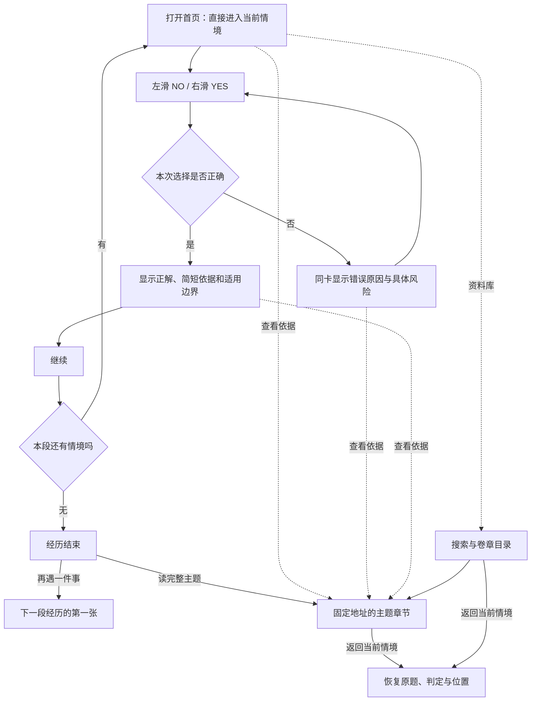

# 不吃亏：刷卡原型设计稿

> 状态：Design / 用户已授权按本稿与完整流程板开始第一轮落地。
> 更新：2026-10-23。范围：五题租车经历、书式资料库与章节返回的本地实现和验证，尚未发布。
> 用户已确认的规则已记入 `product-experience-spec.md`。本文为设计基线，不作为第二套法源或独立题库。首轮运行题目见 `scenario-checks.js`，实际完成状态见 `tasks/todo.md` 与根目录 `design-qa.md`。
> 试玩修订：用户要求以 NO / YES 取代长句选项，并加强题面现场感。当前交互与文案以本稿修订和运行代码为准；已有流程板保留为首轮视觉过程记录。

## 1. 一句话体验

**不花钱，也能买到教训。** 这是用户在本轮进一步明确的价值主线：把现实中往往需要付出代价才能理解的一课，做成屏幕上可以先尝试、看解释和重新选择的情境。

像刷牌一样，走过一段消费经历：一张卡一个行动选择，左滑 NO，右滑 YES；选错立即读解释，在同一题重选；选对才可继续。

这里的“生存”由连续情境和每个选择的现实后果呈现。原型不额外增加生命值、倒计时、分数、等级或排行榜。游戏内判定只说明题面给定事实下的行动判断，不声称答对即可确保现实中不受损失。

### 设计重心：一张卡把一课讲透

- **内容先让人想选**：情境包含具体诱因，如赶时间、图方便、相信品牌、熟人推荐或眼前优惠。待判断动作自然地发生在这个处境里，避免靠“我不核对”“我不留证”等自曝错误的措辞制造唯一答案。
- **解释带来一次理解**：选择后先讲清忽略了什么、可能影响什么，再给一句能记住的判断及适用边界。实际后果须有依据支撑，不虚构确定损失制造刺激。
- **操作保持固定**：滑动跟手，松手判定；错误回弹并直接解释；重选正确后继续。关键反馈做精，步骤不继续堆叠。
- **视觉给情境和反馈让位**：主卡直接进入具体事实与行动，优先减少重复的“现实场景 / 我的做法 / 你会这样做吗”等辅助标题；资料入口留在次级位置。三张已有草图是参考，均需沿这一原则收敛。
- **社会议题落实到具体判断**：消费套路、食品消费安全、行业信息不对称等是潜在题材方向；每个题目仍须先有可靠依据。读者从一张卡获得查证、比较和追问的具体抓手，社会价值由内容的准确和可理解性承载。
- **转发是一种邀请**：值得分享的是“这一步你会怎么选”或“你刚好要遇到这件事”，保留选择的悬念，并让收件人直接进入对应情境。此为待验证的传播方案，不据此宣称已有传播成效。

## 2. 已确认与本轮暂定

| 状态 | 决定 |
| --- | --- |
| 用户已确认 | 左滑 NO、右滑 YES；滑动判断一项具体做法；一屏一张；试玩后明确不用长句选项 |
| 用户已确认 | 答错直接解释原因，在原题重选；答对才解锁继续 |
| 用户已确认 | 原型设计完整后再落地；已在完整流程稿交付后授权第一轮实现 |
| 用户已确认 | “不花钱，也能买到教训”的价值主线；交互和视觉恰到好处，保持操作简单 |
| 本轮暂定 | 初次直接进入租车样例，不先要求选主题、注册或阅读说明页 |
| 本轮暂定 | 首条样例由五张连续情境组成，结束后可换一段经历 |
| 本轮暂定 | 资料库入口置于右上；题目依据与纠错入口在卡片辅助位置 |
| 第一轮已采用 | 保留纸张色、黑字、深红和中文衬线标题，按完整纸牌流程板实现 |
| 本轮暂定 | 刷新或查看依据后恢复当前题和反馈状态；内容版本变更时重新判断当前题 |

## 3. 完整用户路径

“答对才能继续”只约束同一段经历中的前进。用户始终能退出、查资料或关闭页面。读章节不写入答对记录；从资料页返回时不会自动进入下一张。原型第一版不提供任意切换故事或抽走当前难题的旁路。

## 4. 屏幕与状态清单

| 屏幕 / 状态 | 用户看到什么 | 可做的事 | 去向 |
| --- | --- | --- | --- |
| 打开 / 恢复 | 品牌、当前经历、当前卡片；首次有一行滑动提示 | 判断或查资料 | 当前卡片 |
| 待判断 | 情境、一个待判断的动作、左右固定标签；不泄露正解 | 滑动、点等价按钮、查看依据 | 答错或答对 |
| 拖动中 | 卡片随手指轻移，目标侧出现所选动作文字 | 松手提交；缩回撤销 | 原位或判定 |
| 答错 | 保留原情境和动作；就地展开“为什么”；底部仍是两个判断动作 | 阅读后重新选择、查依据 | 留在本题 |
| 答对 | 正解红标、两句以内理由、始终可见的适用边界 | 继续、查看依据 | 下一张或结束 |
| 资料库 | 返回当前情境、搜索、卷章目录 | 找主题、读章节 | 固定章节地址 |
| 章节阅读 | 现实问题、权威依据 / 裁判参考、实践提醒、按需支持、原文 | 阅读、打开官方原文、返回 | 原题原状态 |
| 经历结束 | “这趟租车，先到这里”；四个关键点的一行回顾 | 再遇一件事、读完整主题 | 新经历或章节 |
| 空结果 | 没有匹配主题，搜索内容保留 | 修改关键词、回到目录或情境 | 对应路径 |
| 问题撤下 / 内容更新 | 简短说明该题发生更新，不要求用户反复答旧答案 | 加载现行题或返回资料库 | 有效内容 |

目录与章节保留书式阅读能力，CASE 仍只有 `/c/<slug>/` 这一套规范地址；不另造一套“游戏版法条页”。目录的具体分卷沿现行规范方案继续评审，不以现有十五个细分类平铺占据游戏首页。

## 5. 卡片组成与反馈

### 待判断卡

自上而下：品牌与“资料库” → 经历名 / 所处情境 → 事实 → 待判断的一项行动 → 左右动作。

- 情境与行动合计目标不超过 80 个汉字；行动应是用户此刻能做或不做的事。
- 情境补全决定答案的事实，不把作者偏好或抽象品德判断写成唯一正解。
- 左右只用 NO / YES，分别表示不做 / 做，不在别处反转含义，也不出现“左滑下一张”。
- 两个圆形点击按钮与滑动完全等价，保持同色同权；读屏补充中文动作含义。
- 屏幕内只展示当前题内容。后方若露出牌边，只表达还有下一张，不提前露出题面。
- 简短提示：“左滑 NO · 右滑 YES”。题面直接以动作问句收尾，不重复“你会这样做吗”；不单独开教学弹窗。

### 答错卡

- 卡片回到原位，就地展示“为什么”，无需再点一次“看解释”。
- 解释指出误判的关键事实、这一动作可能带来的风险和更合适的做法，总长目标 60–100 字。
- 沿用同一组左右动作，原题随时可重选；不用“知道了 → 返回 → 再作答”的额外链路。
- 两种选择均继续可用，不把错误项永久禁用。再次选错时不重复抖动、不叠加惩罚，保留解释。
- 理由可以清楚写出正确做法；不为维持悬念而藏起有用知识。前进仍须用户作出正确选择。
- 适用边界和“查看依据”保持可达。没有倒计时，没有“继续”按钮占位。

### 答对卡

- 以深红标“正解”，同时用文字明确动作，颜色不是唯一判定信号。
- 解释这个行动保护了什么判断条件，不写“必胜”“保证退款”“一定不赔”。
- 简短依据链接到对应 `#rule-<ruleId>`，边界直接显示；完整机关、日期和原文在章节里查看。
- 底部主动作变为“继续”。用户主动触发后换卡；不自动倒计时翻走解释。
- 当前正确结果锁定，继续前不因误触重新把本题判错。

### 经历结束

结尾是暂歇，不给成绩。租车样例文案：“这趟租车，先到这里。谁来履约、开什么车、押金怎么退、申诉找谁——需要时还可以回来查。”主动作“再遇一件事”，次动作“读租车这一章”。

第一轮只有租车一段，实际主动作使用“再走一遍”，避免把重复经历说成新内容。后续增加可独立核对的新经历后，再接入“再遇一件事”。

## 6. 首条连续情境：租车的一天

以下为**原型文案**，只有在现有 `legal-updates.js` 对应规则支持时才可进入正式题库。模拟事实不代表真实用户案件。所有样例主 CASE 为 `rental`。2026-10-23 已打开本节所列官方原文进行条文核对；不因此批量改变仓库其他来源的核验状态。

### 付款前

- **情境**：周五晚，你到店取平台上订的车。店员递来付款码：“都是平台合作店，合同和公司信息付完再发。”
- **行动**：先付款，把钥匙拿到手？
- **正解**：NO（左）。
- **答错解释**：这一步容易把品牌当成实际出租方。先拿到出租方的名称、地址和联系方式，再与合同对照，才知道由谁提供租赁服务。
- **答对解释**：先认清实际出租方，再付款。品牌入口和实际服务方可能不同。
- **适用边界**：实际出租方不同不等于欺诈；平台责任仍要看其实际角色与行为。
- **对应规则**：`operator`，法源原文和元信息从 `legal-updates.js` 解析。

### 交押金前

- **情境**：店员指着收款码：“押金两千，还车就退。”你问多久到账，他看了看你身后排队的人。
- **行动**：怎么退、几天到账，先写进订单？
- **正解**：YES（右）。
- **答错解释**：只有“以后会退”，仍不清楚向谁申请、怎么退、等多久。收押金应事先约定退还方式、程序和时限，先问清并保存约定。
- **答对解释**：先问清怎么退、多久退，再交押金。退押约定提前明确，之后才能判断是否符合条件、是否已经超过约定时限。
- **适用边界**：本题讨论押金；预授权冻结等支付方式的解除另看具体约定，不能直接等同于现金押金退款。
- **对应规则**：`deposit`，法源原文和元信息从 `legal-updates.js` 解析。

### 取车时

- **情境**：租的五座自驾车开到门口，行驶证上写着“非营运”。朋友已经上车，店员说：“点确认就能走。”
- **行动**：点“确认交车”，出发？
- **正解**：NO（左）。
- **答错解释**：店员的口头保证不能代替车辆登记核对。投入这类租赁经营的车辆，使用性质应为“租赁”；先要求核清、更正手续，不直接确认交付。
- **答对解释**：先核清车辆登记，再确认交车。核清车辆登记和交付信息，再确认交车，避免把未核实的状态记成已经确认。
- **适用边界**：限本题这类不配驾驶员的小微型客车经营性租赁；不据此直接判定合同无效、保险必不赔或停运费必不赔。
- **对应规则**：`vehicle-status`，法源原文和元信息从 `legal-updates.js` 解析。

### 还车后

- **情境**：还车单勾着“验收通过，押金全退”，约定退款日也到了。店员发来消息：“给个五星，马上退。”
- **行动**：留下这条消息，直接要求退押？
- **正解**：YES（右）。
- **答错解释**：满足退还条件后，经营者应及时退押金，不能临时增加不合理门槛。先按原约定要求退还，并留下门店新增条件的记录。
- **答对解释**：符合退押条件，就按原约定要求退还。把原来的退还条件、时间和门店新要求放在一起核对，诉求会更明确。
- **适用边界**：如有需要核实的车损、违章等约定退还条件，应先核实争议；不能把所有未退都当成无条件应退。
- **对应规则**：`deposit`，法源原文和元信息从 `legal-updates.js` 解析。

### 平台申诉

- **情境**：平台按规则扣了你三百元。申诉页只有 AI 回复：“驳回，已结案。”你找到了“申请人工”入口。
- **行动**：已经结案，还要申请人工？
- **正解**：YES（右）。
- **答错解释**：AI 显示“已结案”，不等于不能要求人工判定。这类申诉中，你提出人工判定要求后，平台不能仍只用 AI 处理；提出要求，并保存回复。
- **答对解释**：要求人工复核，并保留平台回复。这类平台规则申诉中，你提出人工判定要求后，平台就不能只用 AI 处理。
- **适用边界**：限平台执行平台规则、对不利措施进行申诉复核的情形；人工复核不等于必须支持你的实体诉求。
- **对应规则**：`platform-appeal`，法源原文和元信息从 `legal-updates.js` 解析。

题面顺序在首条原型固定，以验证故事连贯性。五张均为单独可解释的情境，不把前题选择虚构成真实财产损失。左右正确答案都有，不靠连续左滑通关。

“到店没车自行取消”暂不进入本条样例：其履约与取消后果需要先补进现有权威依据层，不能只因旧 CASE 正文曾写过就另在题目里确立唯一答案。

## 7. 资料库与返回设计

- 游戏首屏右上只有一个“资料库”入口，目录和搜索合在同一资料入口中，不把筛选区堆到卡片下面。
- 资料库与从卡片进入的章节顶部显示“返回当前情境”；回去恢复原题、已展开解释、答对状态及位置。
- “查看依据”直达 `/c/rental/#rule-…`，定位当前规则。正文仍可继续阅读，原文仍能直接打开。
- 从搜索引擎直接进入章节的读者先读正文，不要求先答题；可用“试一个情境”开始这段经历。
- “这题有问题”以低权重文字链接出现，打开预填题目、方向与页面信息的 GitHub issue，不发送消费者亲历，不接入 Supabase 队列。
- 发布内容以 GitHub main 为准；原型里的问题纠错只展示目标和返回行为，不代用户提交任何 issue。

## 8. 手势、键盘与移动布局

- 390×844 为主设计画布。卡片宽约 342–358px，随可用宽度缩放；小屏或大字时允许纵向阅读，不强制压缩到固定高度。
- 拖动超过约 72px 且水平意图明确才在松手时判定；不到阈值回弹，不判错。纵向滑动用于阅读，不能变成判断。
- 拖动预览显示动作文字，只在提交后显示对错；“右”不等于“正确”，不能预先给右侧正确色。
- 用户选中文字、点链接或按钮时不启动拖牌。手势提交期间短暂防重复，松手一次只记一个选择。
- 错误后轻回弹并展开解释；答对后等待用户点“继续”，才让旧牌离场、下一张进入。动效目标 180–240ms，不做 3D 翻面。
- 减少动态效果开启时直接切换状态，全部信息和动作仍在。
- 两个判断按钮触摸目标至少 44px；答对状态只保留一个主“继续”，避免已经答对还出现可误触的判断按钮。
- 键盘焦点在卡片时左右方向键对应判断；Tab 可到两个按钮、资料库与依据；输入搜索时不拦截方向键。
- 判定以文字和 aria-live 提示；解释可以重新阅读，不随定时器消失。不凭截图宣称读屏合规。
- 桌面仍呈现单张主牌，保留按钮和键盘；不扩成左右三栏后台，不新增鼠标专属功能。

## 9. 中断、恢复与内容更新

| 情形 | 原型预期 |
| --- | --- |
| 松手前滑回 | 取消选择，保留原状态 |
| 从错误状态读依据并返回 | 同一题、错误解释保持展开，仍须正确选择后继续 |
| 从正确状态读依据并返回 | 同一题仍显示继续，不要求再答 |
| 刷新 / 重新打开 | 优先恢复当前经历、当前题及已显示的判定；首次没有恢复信息则从样例开始 |
| 重复点击继续 | 只前进一张，不连跳 |
| 当前题依据失效 / 被撤下 | 系统移出该题并说明已更新，不让用户困在无法合法判对的题上 |
| 当前题文案或答案已更新 | 本题重置为待判断，显示“这个情境已更新，请重新判断”；旧判定不沿用 |
| 题目数据加载失败 | 提供重试与资料库入口，不把空白页当成游戏开局 |
| 官方原文打不开 | 读者可返回当前情境；不声称该链接已验证可用，不自动换成机构首页 |

恢复用于继续阅读，不引入账户、公开排名或新的消费者数据收集。本轮只规定体验，不提前指定存储实现。

## 10. 视觉比较与完成条件

第一轮用同一张“品牌与出租方”待判断卡生成三张独立手机图，比较纸牌层级、对话现场感、行动语句的强调。它们是待选视觉草图，不能当作已经通过交互测试的可用页面。

本轮三张草图已按实际展示顺序保存：[1](prototype-assets/2026-10-23/01-card.png)、[2](prototype-assets/2026-10-23/02-card.png)、[3](prototype-assets/2026-10-23/03-card.png)。生成提示词、来源与草图偏差记录见[生成记录](prototype-assets/2026-10-23/README.md)。尚未选定方向；图中辅助文字、按钮权重等仍须按本稿校正，不以图片覆盖交互规则。

用户继续授权推进原型后，第二轮以第一张的纸牌结构作为**工作稿**，压缩重复标签并采用本节更新后的题面；这不是用户已经选定的最终视觉。第二轮完整静态流程的评审说明见[完整流程原型](prototype-flow-review.md)。

第二轮已补齐五张静态流程板：待判断、答错重选、答对继续、下一张、经历结束、朋友打开原题、资料库、规则定位章节、搜索无结果、向左 / 向右拖动预览、缩回取消，以及桌面单牌布局。返回恢复、中断、内容更新和加载失败有明确状态约定。整体评审与真实交互验证仍待完成；静态画面不等于完整原型获批，不触发生产站点实现。

后续用户已明确授权按这套完整稿开始第一轮落地，因此当前以第二轮流程板作为实现目标，不再等待首轮三张候选卡面的选择。原图仍保留探索记录身份；本地实现的检查以 `design-qa.md` 和当前待办为准，不自动触发发布。

原型评审通过条件：

1. 第一次打开就知道判断的是哪项动作，能直接尝试。
2. 左右含义始终一致，点击和键盘也能完成同样流程。
3. 答错后立即解释、留原题可重选；答对前确实不能前进。
4. 答对后的理由、适用边界和依据可见，继续由用户主动触发。
5. 原题与解释可以同时找到，错误状态不多出一串关闭 / 返回按钮。
6. 从依据或资料库返回能恢复原状态。
7. 完整租车样例可走到结尾，结尾两个去向有明确落点。
8. 每张正式题只引用现有有效 ruleId；更改规则须同步复核题面与例外。
9. 390px、文字放大、减少动态效果、键盘与真实读屏行为都需检查。
10. 用户明确确认完整原型后，才同步正式实现、生成物、契约与发布检查。
