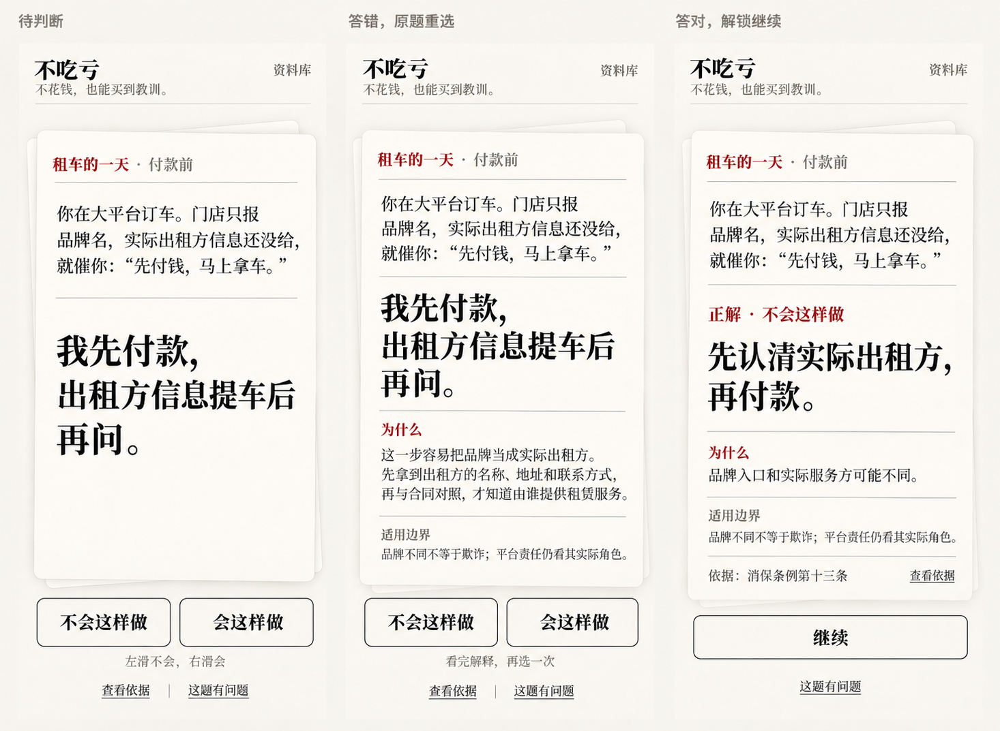
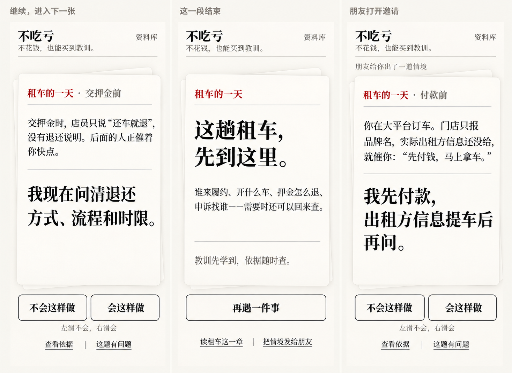
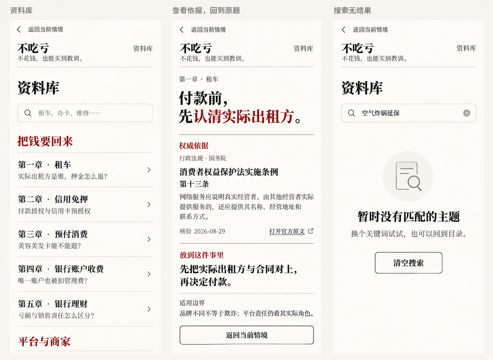
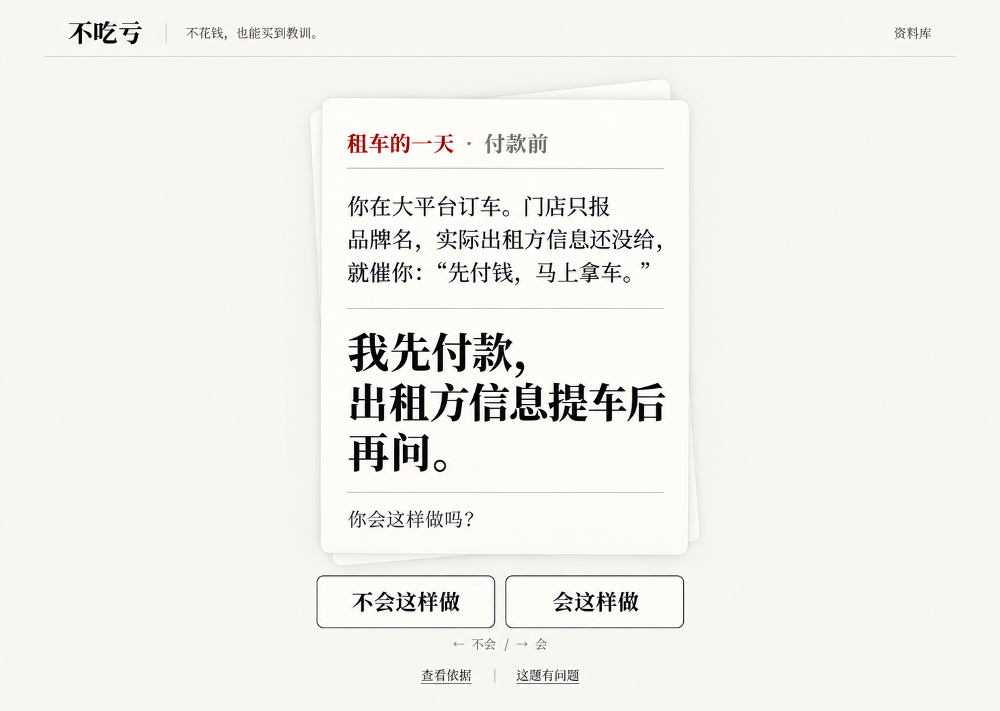
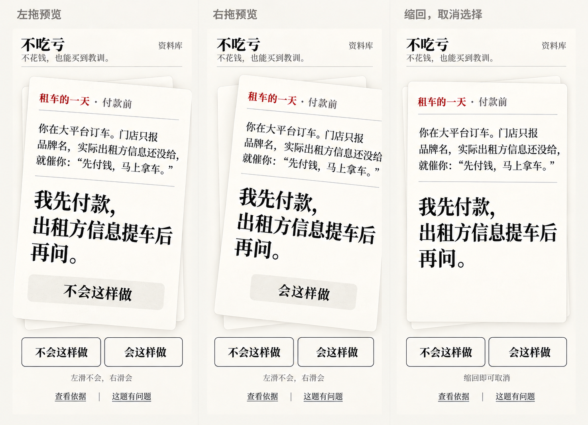

# 不吃亏：完整流程原型评审稿

> 状态：静态流程设计基线，2026-10-23 已获用户授权开始第一轮落地。
> 本稿与画面仍用于设计对照，不能代替交互测试；当前本地实现与验证记录见根目录 `design-qa.md` 和 `tasks/todo.md`，尚未发布。
> 内容与交互细节以 `prototype-design.md` 为准；法源以现有权威材料层为准。
> 后续试玩修订：用户明确改用 NO / YES 短选项，并加强现场题面。以下图片保留首轮工作稿，长句按钮和旧题面不再作为当前运行界面的要求；最新文案与交互见 `prototype-design.md`。

## 这一轮要看什么

核心表达：**不花钱，也能买到教训。** 一张卡直接进入有诱因的处境，选择后获得解释，再决定继续或查证。工作视觉沿用第一轮纸牌结构，减少标签、描边和无关说明，不新增操作规则。

本轮包括五张流程板：十二个手机状态画面和一张桌面画面。它们是一套工作设计的不同状态，不是五种备选风格。五道租车样例的完整文案与规则对应见[原型设计稿第六节](prototype-design.md#6-首条连续情境租车的一天)；图像是视觉参考，不覆盖该稿的准确措辞。

## 一：从判断到理解

三屏固定是同一题，不能看成三个不同的题目。

| 屏幕 | 重点内容 | 用户动作与结果 |
| --- | --- | --- |
| 待判断 | 门店没提供实际出租方信息，催你先付款；你考虑提车后再问 | 左滑不会 / 右滑会；两个按钮等价，不能提前出现正确提示 |
| 答错 | 原情境与动作保留，下方直接解释“品牌与实际出租方可能不同”及其现实影响 | 留原题重选；这道题左侧为正解，不能出现继续 |
| 答对 | 显示“正解 · 不会这样做”，把正确做法提炼为“先认清实际出租方，再付款” | 阅读简短理由与适用边界，点击继续才前进 |

答错后的解释直接可读，不要再增加打开、关闭和返回的动作。答对画面的大字表达正确行动，避免让原错误行动紧挨“正解”却没有明确否定。

**评审时以此句校准边界**：“实际出租方不同不等于欺诈；平台责任仍要看其实际角色与行为。”图中缩短成“品牌不同”不够准确，后续排版使用完整句，并允许换行，不压小字号硬塞。

## 二：继续、结束与传播入口

| 屏幕 | 重点内容 | 用户动作与结果 |
| --- | --- | --- |
| 下一张 | 押金只有“还车就退”的口头说法，后面的人催你；你考虑现在问清流程与时限 | 当前正确方向是右；方向含义不变，每题正确方向可不同 |
| 这一段结束 | “这趟租车，先到这里”；回顾履约主体、车辆、押金与申诉 | 主动作“再遇一件事”；可读租车章节或邀请朋友判断 |
| 朋友打开邀请 | 进入被分享的原题待判断态，小字说明朋友给出一段情境 | 不带发送者的答案、判定或完成状态，接收者可直接判断 |

分享设计传递的是同一段待判断情境。它是题目链接或题面卡片的设计，不实际向第三方发消息、不代用户提交内容。游戏问题反馈仍去 GitHub issue；消费者经历仍归原 Supabase 队列。

## 三：资料库、依据与回到原题

| 屏幕 | 重点内容 | 用户动作与结果 |
| --- | --- | --- |
| 资料库 | 搜索 + 书式目录，少量真实主题标题，顶部有“返回当前情境” | 可以查找和读章节；返回游戏保留原题与原判定 |
| 规则定位章节 | 租车章节，定位当前 `operator` 规则；显示来源、解释、边界和官方原文 | 读取完整依据；返回时仍在答错或答对前的原状态 |
| 无匹配结果 | 搜索文字保留，明确暂无匹配 | 可清空或改词；可直接返回当前情境 |

章节的规范地址仍是 `/c/rental/`；当前规则定位为 `#rule-operator`。目录分卷仍沿现行规范方案评审，不为原型增加第二套内容编号。资料库示意条目来自现有主题，不代表新增内容已经完成。

这里展示的是章节中的规则定位区域，不是新增独立法条页面。向上仍能阅读本章现实问题，向下仍有完整主题内容与原文。图中核验日期保留现有记录的 2026-08-29；不会因为生成原型图就改成今天。

## 四：桌面与操作细节

桌面仍是一张主牌，保留相同左右按钮。卡片聚焦时可用左右方向键；搜索输入时不拦截方向键。选择后 Enter 不应全局自动跳题，继续需要明确触发。宽屏不扩展成仪表盘或多栏任务系统。

手势设计约定：

- 拖动时只预览方向及“会 / 不会”，不能把右侧预先标成正确。
- 超过约 72px 且水平意图明确，在松手时才提交；缩回则撤销。
- 纵向阅读、选文字、点来源不触发判定。
- 错误轻回弹并立即解释；正确等待继续，再换下一张。
- 动效目标 180–240ms；减少动态效果下直接切换，同样可完成。
- 当前正确反馈锁定，双击继续也只前进一张。

拖动图只用于看预览文字与归位状态。图中左右旋转没有准确形成镜像；交互原型应分别向左、向右随手移动，轻微旋转方向与拖动一致，不能把两张图的相同倾角照搬为动效。具体阈值、位移和动效时间须用真实操作验证。

## 五：中断与异常也要有去向

这些使用同一卡片的简短文字状态，不增加弹窗或新流程。导航、查看依据与关闭页面始终可用。

| 情形 | 画面文字 / 行为 | 主动作与返回 |
| --- | --- | --- |
| 第一次加载尚未完成 | 预留卡片空间，显示“正在准备情境……”；不显示可判断的半张题面 | 完成后进入待判断；加载失败时提供重试 |
| 题目加载失败 | “这个情境暂时没能打开。” | “重试”；次级“去资料库” |
| 当前题文案或答案更新 | “这个情境已更新，请重新判断。”；显示现行题，清除旧判定 | 仍是会 / 不会，不继承旧答案 |
| 当前题撤下 | “这个情境已更新，暂时不再提供判断。” | “加载现行情境”；次级“去资料库”，不标为已答对 |
| 从依据返回 | 恢复进入前的题面、解释展开状态与位置 | 错误仍可重选，正确仍可继续 |
| 重复选错 | 原因保留，不反复抖动或叠加惩罚文案 | 同一题重选 |
| 文字放大或小屏高度不足 | 自然纵向阅读；卡片不强制固定高度，动作仍在阅读顺序里 | 不缩小解释与边界来保持一屏 |

## 图像与正式排版之间

本组为 ImageGen 静态工作图。排版时统一事实、行动、解释与边界的字号层级；保留暖纸色、黑字和深红正解，减少过多分隔线。资料库页不必在导航里重复显示同页入口。桌面阶段行目前在牌内，后续与手机统一，且不扩大牌面填满屏幕。

原图、参考关系、完整提示词、尺寸和已知偏差见[生成记录](prototype-assets/2026-10-23/flow/README.md)。制图阶段没有创建题库或修改运行代码；后续已获授权进行第一轮实现，没有自动发布或代发分享。

## 评审顺序

1. 先看待判断卡，是否不用说明就知道自己判断哪项行动。
2. 故意选择右侧答错，检查解释是否直接、具体、读得下去。
3. 重新选择左侧，检查“答对才继续”是否明确，边界是否可见。
4. 进入下一张，确认同一方向没有被偷偷改成“正确 / 错误”。
5. 去资料库与依据页，再返回，确认设计要求保留原题原状态。
6. 看结束和邀请入口，确认经历有停顿、分享有清楚落点。

真实触摸手感、可恢复导航、390px 浏览器溢出、键盘和读屏行为，必须在原型画面确认后用可交互原型再验证。静态画面不能代替这些检查。
