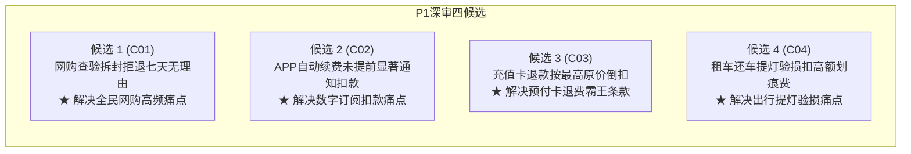

# 18 章来源盘点、12 候选问题与 4 个优先深审清单（P0 阶段交付）

日期：2026-10-25 · 依据：[三库完善计划](library-improvement-plan.md) 第 3 节。  
状态：P0 案例库盘点交付；梳理 18 章法源储备，筛选 12 个贴近日常生活的候选消费问题，锁定 4 个进入 P1 深度审核。

---

## 1. 既有 18 章真实法源与案例储备盘点

根据当前数据库（`data/content.sqlite`）与语料库（`corpus/`）的盘点：
- **总来源数**：149 条（法律法规 81 · 案例裁判 39 · 参考资料 18 · 官方办事入口 11）；
- **已核验（`verified`）来源**：110 条；
- **待核验（`needsReview/collected`）背景语料**：39 条（作为背景储备，严格**禁止直接计入可用出题储备**）；
- **公开题目关联案例**：已核验的 8 个直接支撑案例。

### 18 个章节储备成熟度分类：
1. **高成熟度（具备直接出题与丰富核验案例）**：
   - `after-sales`（售后服务：写真退订、电池换新、二手闲置、七天无理由）
   - `travel-booking`（旅游预订：无购物团行程、到店付提前扣款）
   - `beauty-hair`（预付消费：健身卡退费、乐园年卡、培训迁址）
   - `rental` / `rental-credit-card-first`（租车：免押预授权、停运费抗辩）
2. **中成熟度（法源权威扎实，待提炼出题短读）**：
   - `mobile-plan-cost`（通信：在售套餐自由变更、增值业务扣费）
   - `bank-small-account-fee`（银行：唯一账户小额账户管理费/年费退费）
   - `appliance-repair-trap`（维修：明码标价、家电维修假冒官方）
   - `airport-sales-pitch`（线下推销：机场商旅卡夸大权益、销售主体混淆）
3. **低成熟度 / 窄场景（适合资料库专栏阅读，不适宜作为普适问卷题）**：
   - `alibaba-auction-trap`（阿里拍卖：拍卖托儿与委托人关系）
   - `thailand-travel-safety`（境外安全：泰缅边境安全预警）
   - `layoff-compensation`（劳动仲裁：被裁与代通知金计算）
   - `alipay-advisor-cost`（投资投顾：投顾综合成本）
   - `dating-safety`（人身财产：相亲防托儿安全）
   - `internet-court-self-litigation`（诉讼操作：互联网法院诉讼流程）
   - `transport-platform-layered-fees`（平台运价：网约车/货车司机运价抽成）

---

## 2. 筛选出的 12 个候选日常消费波折问题

依据“日常接触面高、损害概率大、能讲清一条行动提醒、有官方裁判或监管依据”四大维度，从 18 章及高频合规场景中筛选出以下 12 个问题：

| 序号 | 现实用户消费波折问题 | 关联章节 | 涉及经历机制 | 接触面评级 | 法律权威支撑状态 |
| :---: | :--- | :--- | :---: | :---: | :--- |
| **C01** | 网购衣服试穿或数码产品开箱查验，商家以“已拆封影响二次销售”为由拒绝七天无理由退货。 | `after-sales` | 机制 C （退订受阻） | 极高 （全民网购） | **已核验**：最高法网络消费纠纷司法解释三条、典型案例。 |
| **C02** | 开通优惠会员后被默认绑定自动续费，扣款前没有提前以显著方式提醒，悄悄扣了下一期费用。 | `mobile-plan-cost` / 数字消费 | 机制 B （安排变动） | 极高 （手机软件） | **已现行**：《网络交易监督管理办法》第 18 条、《消法实施条例》第 10 条。 |
| **C03** | 办打折充值卡中途退费，商家要求“按门市最高原价重新核算已消费项目”，导致剩余卡费几乎扣光。 | `beauty-hair` | 机制 C （结算受阻） | 很高 （美业/健身） | **已现行**：各省消保条例、民法典合同编、典型裁判案例。 |
| **C04** | 租车还车时商家拿着强光手电“提灯验损”，指着极微小划痕索赔高额喷漆费和无依据停运费。 | `rental` | 机制 C （结算受阻） | 中高 （自驾出行） | **已核验**：小微型客车租赁服务规范、宁夏/珠海法院民事判决。 |
| **C05** | 演出票 / 电影票购买后因突发原因无法前往，平台以“不支持退改”霸王条款拒绝任何退票改签。 | `after-sales` / 文化演出 | 机制 C （退订受阻） | 中高 （青年受众） | **现行法源**：消法第 26 条（格式条款无效）、中消协演出票务倡议。 |
| **C06** | 线上报名职业培训或学车，承诺“包过 / 不过全额退款”，未过时却依据合同小字仅退少量费用。 | `beauty-hair` / 培训服务 | 机制 A （承诺落差） | 中等 （考证考驾） | **已核验**：虚假承诺与合同格式条款纠纷裁判。 |
| **C07** | 预订民宿 / 酒店到店后被告知“房间已被其他人入住，需加价升级或移到远处分店”。 | `travel-booking` | 机制 B （安排变动） | 中高 （假期出行） | **现行法源**：民法典合同编（单方违约加价）、在线旅游服务管理规定。 |
| **C08** | 手机营业厅在办业务时被擅自添加收费增值业务（流量包/彩铃），连续扣费多月未发提醒短信。 | `mobile-plan-cost` | 机制 B （安排变动） | 极高 （通信日常） | **现行法源**：工信部电信服务规范、工信部关于规范电信业务营销通告。 |
| **C09** | 网上搜索家电维修上门，假冒官方师傅虚构故障乱报价（如更换小电容收费数百元）。 | `appliance-repair-trap` | 机制 A （承诺落差） | 中高 （家庭生活） | **现行法源**：商务部《家电维修服务管理办法》、明码标价规定。 |
| **C10** | 寄递贵重物品出现严重破损，快递公司以“寄件未保价”为由主张仅按运费数倍赔偿几十元。 | `transport` | 机制 C （结算受阻） | 中高 （寄递日常） | **现行法源**：民法典客运合同、最高法快递保价典型裁判。 |
| **C11** | 线下推销商旅卡 / 贵宾卡，声称“机票酒店直接抵扣现金”，使用时发现每次仅能抵扣极少比例。 | `airport-sales-pitch` | 机制 A （承诺落差） | 中等 （商旅出差） | **已核验**：检察日报商旅卡套路通报、反不正当竞争法虚假宣传。 |
| **C12** | 线上买数码设备在三包期内故障，售后以“机身有微小磕碰推定人为损坏”拒绝免费保修。 | `after-sales` | 机制 A （承诺落差） | 很高 （电子消费） | **现行法源**：移动电话机等三包规定、消费者权益保护法。 |

---

## 3. 锁定 4 个优先深审候选清单（供 P1 阶段深入审核）

经综合评估**受众高频度**、**证据充分性**、**对现有 8 题覆盖缺口的补足能力**，锁定以下 4 个优先深审候选进入 P1 阶段：

### 3.1 候选 1：网购查验拆封拒绝“七天无理由退货”（C01）
* **现实问题**：网购衣服拆开试穿、数码产品开箱通电验机，商家一律声称“包装已拆开影响二次销售”直接拒绝七天无理由退款。
* **对应章节**：`after-sales`（售后服务）
* **支撑法源**：《最高人民法院关于审理网络消费纠纷案件适用法律若干问题的规定（一）》第三条（明确规定消费者因检查商品的必要对商品进行拆封查验且不影响商品完好，电子商务经营者不得以商品已拆封为由主张不适用七日无理由退货制度）；
* **经历机制**：机制 C（结算与退订受阻）或 机制 A（七天退换承诺落差）；
* **预期核心提醒**：**查验商品必要拆封且未超出合理范围的，拆封本身不影响退货；但注意防伪标签、封条勿撕毁，特定不适用商品（如定制、鲜活易腐）除外。**

### 3.2 候选 2：APP 会员自动续费未在扣费前显著通知（C02）
* **现实问题**：开通首月优惠或试用会员后，软件默认绑定自动续费，且在扣款日前未以短信、弹窗等显著方式提前通知，悄悄从微信/支付宝划扣年费或连续月费。
* **对应章节**：`mobile-plan-cost` / 数字订阅服务
* **支撑法源**：《网络交易监督管理办法》第十八条（网络交易经营者采取自动续费方式提供服务的，应当在续费日期前五日，以显著方式提请消费者注意，由消费者自主选择）；2024 年 7 月 1 日生效的《消费者权益保护法实施条例》第十条；
* **经历机制**：机制 B（扣款时点与安排被单方推移）或 机制 C（扣费阻碍）；
* **预期核心提醒**：**凡是打着“首月1元/免费试用”的会员，开通当天立即在支付软件（微信/支付宝/苹果）的“扣费服务”中关闭自动续订，不影响首月使用。**

### 3.3 候选 3：充值卡未消费申请退费，商家按门市最高原价折算（C03）
* **现实问题**：办理理发/健身/美容打折卡，充值后中途想退款，商家声称“折扣优惠仅限卡内消费完毕，退卡需按单次门市最高原价重新结算此前项目”，导致卡内原本剩余的数百上千元退费归零。
* **对应章节**：`beauty-hair`（预付消费）
* **支撑法源**：消法第 53 条、民事审判典型裁判观点（预付费退费应按实际发生的优惠折算比例分摊，经营者不得通过格式条款单方提高已消费项目的计费标准）；
* **经历机制**：机制 C（预付与结算受阻）——完美作为 Q4（乐园闭店）的优质替换候选；
* **预期核心提醒**：**中途退还预付卡时，已消费金额必须按购卡时的实际折扣比例折算，商家无权擅自改用原价倒扣剩余本金。**

### 3.4 候选 4：租车还车提灯验损被索要无依据划痕费与停运费（C04）
* **现实问题**：租车还车时，商家用强光手电贴着车身“提灯验损”，找出陈旧细小划痕，要求赔偿上千元整面喷漆费，并无凭无据强制划扣数天停运损失费。
* **对应章节**：`rental` / `rental-credit-card-first`
* **支撑法源**：交通运输部《小微型客车租赁经营服务管理办法》、宁夏银川市兴庆区人民法院 / 珠海市香洲区人民法院关于停运损失必须提供真实营运损失证明的裁判判例；
* **经历机制**：机制 C（结算扣款阻碍）或 机制 A（承诺落差）；
* **预期核心提醒**：**提车时务必绕车拍摄完整高清视频（重点录清轮毂、裙边和现有划痕）；还车遭遇划痕争议时，要求对方出具定损单及实际停运证明，严禁直接从免押额度扣除。**

---

## 4. P1 阶段准入结论与衔接说明

1. **4 个优先候选均具备现行法源或司法判例支撑**，无一依赖网络传言或未核验小道消息；
2. **场景覆盖兼顾日用网购、手机软件、生活预付与自驾出行**，极大丰富了题目的生活普适性；
3. **P0 任务完成度达标**，满足 PRD 第 5 节 P0 退出门槛，已具备进入 P1 深度事实与文本审核的条件。
