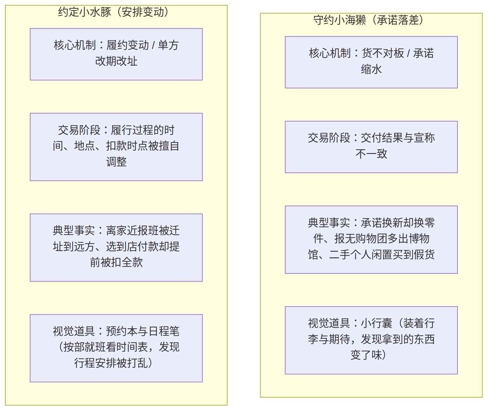

# 六角色价值定义与对比规范（P0 阶段交付）

日期：2026-10-25 · 依据：[三库完善计划](library-improvement-plan.md) 第 2 节。  
状态：P0 产品与设计定义，已对齐现行经历机制；待与真人测试盲测对比。

---

## 1. 六角色全要素定义表

| 字段 | 守约小海獭 (`otter`) | 约定小水豚 (`capybara`) | 细致小浣熊 (`raccoon`) | 故事小狐狸 (`fox`) | 初见/轻盈小团雀 (`bird`) | 留白小云朵 (`cloud`) |
| :--- | :--- | :--- | :--- | :--- | :--- | :--- |
| **稳定 ID** | `otter` | `capybara` | `raccoon` | `fox` | `bird` | `cloud` |
| **推荐名称** | **守约小海獭** | **约定小水豚** | **细致小浣熊** | **故事小狐狸** | **轻盈小团雀**（备选：初见小团雀、清醒小团雀） | **留白小云朵** |
| **视觉道具与画面** | 圆润小海獭抱着旅行行囊，神情温柔 | 圆润小水豚抱着预约本与笔，神情温和 | 小浣熊拿着放大镜和购物袋/票据，神情好奇 | 小狐狸带着几件生活小物与背包，神情友善 | 圆滚滚小团雀背着轻巧双肩包，振翅轻飞 | 柔软蓬松的小云朵微笑着漂浮 |
| **事实描述短句** | 把约定装进小行囊，记录这次遇到的说好与实际落差。 | 把约定装进小本子，看看这次记录里原本安排的单方调整。 | 拿着放大镜清点手边票据，记录这次预付与结算遇到的阻碍。 | 几组不同的消费经历交织，在这次答卷里都留下了波折线索。 | 本次答卷中，没有报告这些常见的消费遭遇。 | 先留出一点空白，回答还不足以为你生成明确的经历特征。 |
| **生成算法依据** | 总非 skip $\ge 6$ 且每机制非 skip $\ge 1$；机制 A（承诺落差）YES 比例严格胜出 | 总非 skip $\ge 6$ 且每机制非 skip $\ge 1$；机制 B（安排变动）YES 比例严格胜出 | 总非 skip $\ge 6$ 且每机制非 skip $\ge 1$；机制 C（结算受阻）YES 比例严格胜出 | 满足覆盖门槛；至少两个机制的 YES 比例精确并列且均大于 0 | 满足覆盖门槛；全部回答均为 NO（或有 skip 但所有已答均为 NO） | 总非 skip $< 6$ 或存在某个经历机制回答数为 0（全部跳过） |
| **禁止推断与红线** | 严禁推断受访者天真守约、识货、轻信或容易受骗 | 严禁推断受访者性格温顺、不敢拒绝、不懂维权或逆来顺受 | 严禁推断受访者爱占便宜、小气、精于算账或过分计较 | 严禁推断受访者是全能大师、老手、容易中招或吃亏最多 | 严禁推断受访者是新手、消费少、无敌防骗、拥有高辨别能力或已识破所有骗局 | 严禁推断受访者涉世未深、消费经历匮乏、不配合或防范能力不足 |
| **两则推荐案例策略** | 首则：机制 A 中优先级最高之 YES 案例； 次则：另一机制之 YES 案例（优先不同主题分类）或跨主题入门案例 | 首则：机制 B 中优先级最高之 YES 案例； 次则：另一机制之 YES 案例（优先不同主题分类）或跨主题入门案例 | 首则：机制 C 中优先级最高之 YES 案例； 次则：另一机制之 YES 案例（优先不同主题分类）或跨主题入门案例 | 首则：胜出机制 1 中优先级最高之 YES 案例； 次则：胜出机制 2 中优先级最高之 YES 案例（优先不同主题分类） | 精选两则跨不同场景的高权重、高启发性入门核验案例（当前为跟团游与预付卡退费） | 精选两则跨不同场景的高权重、高启发性入门核验案例；若有单项 YES，首则优先回应其 YES 案例 |
| **公共分享卡文案** | 抱好行囊，带走一条消费提醒。 | 翻开约定，带走一条消费提醒。 | 算清账目，带走一条消费提醒。 | 走过波折，带走一条消费提醒。 | 轻轻飞过，也把提醒带走。 | 留一点空白，带走一条消费提醒。 |
| **无障碍替代文本** | 圆润的小海獭抱着旅行包，神情温柔。 | 圆润的小水豚抱着预约本，神情温柔。 | 小浣熊带着放大镜和购物袋，神情好奇。 | 小狐狸带着几件生活小物，神情友善。 | 圆滚滚的小团雀背着小背包，神情好奇。 | 柔软的小云朵露出温柔微笑。 |
| **现行版本与证据** | `portrait-2` · `promise-gap` 机制（Q1/Q7/Q8） | `portrait-2` · `arrangement-change` 机制（Q2/Q5） | `portrait-2` · `settlement-obstacle` 机制（Q3/Q4/Q6） | `portrait-2` · 整数交叉相乘并列判定 | `portrait-2` · YES 计数为 0 判定 | `portrait-2` · 覆盖门槛不满足判定 |

---

## 2. 核心角色辨识与防混淆对比（海獭 vs 水豚）

### 2.1 区分痛点与设计原则
在上一轮独立复核与产品评审中，最容易造成用户概念混淆的是**海獭（承诺落差）**与**水豚（安排变动）**。二者都包含“与先前约定不同”的要素，若不从经历机制与记忆抓手上做硬核区隔，极易被认为是同一类问题。

### 2.2 核心记忆点对比

### 2.3 问卷设计与文案区隔规则
1. **海獭侧重“内容与品质落差”**：核心字眼为“宣称与实际”、“说好的与拿到手的”。用户是在验收成果或参与行程时发现实物/内容缩水。
2. **水豚侧重“流程与履约条件变动”**：核心字眼为“临时通知改到别处”、“还没到约定时点就被改变扣款规则”。用户是在履约流程推进中被单方面推翻了时间、地点或结算节点。

---

## 3. 小团雀特别规则规范

### 3.1 认领感与名称候选评估
* **“初见小团雀”**：
  - 现状：现有默认名称。
  - 风险：受访者容易产生“我是不是刚开始消费的新手”、“是不是没见过世面”的负面认知，降低无波折用户的认领自豪感。
* **“清醒小团雀”**：
  - 风险：强烈暗示受访者具备“洞察骗局的高超辨识能力”，违反了“不从遭遇推断能力水平”的不可推断红线。
* **“轻盈小团雀”（本次推荐候选）**：
  - 优势：强调“轻盈飞过，没有沾染常见的消费麻烦”，既肯定了其答卷状态的轻松愉快，又完全不作智力或防骗技能的价值评价。在 P3 真实验收中作为主要测试项。

### 3.2 结果页文案的分母诚实区分
1. **八题全为 NO（100% 确认无遭遇）**：
   - 结果文案：“这次八个场景中，没有报告常见的消费波折。”
2. **有 skip 且其余全为 NO（部分未回答）**：
   - 严禁宣称“完全没遇到过”或“零中招”；
   - 结果文案：“已回答的场景中，未报告这些遭遇；另有 X 题暂未回答。”

### 3.3 法律事实与分享卡隔离红线
- **严禁虚假定性**：不能把旅游变更、预付退费等普通合同违约争议泛化包装为“骗局”或“杀猪盘”；
- **分享卡隐私隔离**：公开分享卡导出的文案统一固定为角色通用短句：“轻轻飞过，也把提醒带走。”绝不把“答题记录”、“八题全 NO”等个人答卷事实输出到公开图片上。

---

## 4. 留白小云朵（不足状态）的保护机制

1. **平等视觉品质**：插画与正规角色同等精致温暖，坚决不使用灰色、失败图标、锁头或“答卷不合格”等惩罚性视觉语言；
2. **正面建设性反馈**：明确提示“先留出一点空白，回答还不足以为你生成明确的经历特征。你依然可以带走下方的真实案例”，并保留两条高价值核验案例；
3. **补充修改入口**：结果页底部明确提供“返回上一题”修改或补全答卷的途径。
