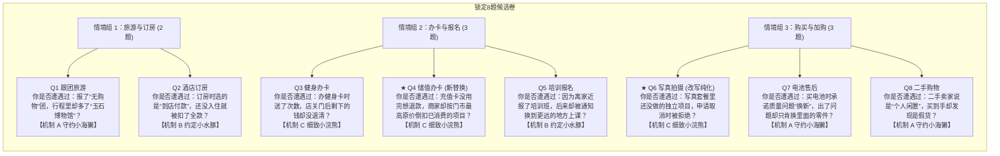

# 题库处置评审、新题草稿与候选卷锁定（P1 阶段交付）

日期：2026-10-25 · 依据：[三库完善计划](library-improvement-plan.md) 第 4 节与 [P1 案例审核](p1-case-review.md)。  
审核状态：题库处置评审完成；已锁定 Q4 替换方案、Q6 改写方案、4 道新题草稿与新版 8 题候选卷。

---

## 1. 现行 8 题逐项处置审查结论

对现行 8 道经历自述题逐一进行场景真实度、复合干扰度与同质化审查：

| 题号 | 题目 ID | 当前公开问句 | 所属机制 | 缺陷诊断与证据审查 | 最终处置决定 |
| :---: | :--- | :--- | :---: | :--- | :---: |
| **Q1** | `survey-tour-museum` | 你是否遭遇过：报了“无购物”团，行程里却多了“玉石博物馆”？ | 机制 A 承诺落差 | 经典宣传承诺与实际行程落差；文旅处罚通报确凿。 | **保留原卷** |
| **Q2** | `survey-arrival-payment` | 你是否遭遇过：订房时选的是“到店付款”，还没入住就被扣了全款？ | 机制 B 安排变动 | 付款方式与时点单方变更；最高法客房个案支持。 | **保留原卷** |
| **Q3** | `survey-prepaid-gift` | 你是否遭遇过：办健身卡时送了次数，店关门后剩下的钱却没退清？ | 机制 C 结算受阻 | 涉及赠送次数的折算权益，与 Q4 闭店同质化，但法律点更独特。 | **保留原卷** |
| **Q4** | `survey-annual-closure` | 你是否遭遇过：儿童乐园年卡还没到期，门店就关门了？ | 机制 C 结算受阻 | **同质化严重**：与 Q3 同为门店倒闭跑路，挤占机制 C，且受众局限于亲子群体。 | **正式替换** （退役入库） |
| **Q5** | `survey-training-relocation` | 你是否遭遇过：因为离家近报了培训班，后来却被通知换到更远的地方上课？ | 机制 B 安排变动 | 履约地点变更显著增加履约成本；最高法培训个案支持。 | **保留原卷** |
| **Q6** | `survey-photo-unfinished` | 你是否遭遇过：写真套餐一再加钱升级，想取消还没做的项目时却被拒绝？ | 机制 C 结算受阻 | **复合度过高**：“一再加钱升级”与“取消未做项目”两个动作叠加，分散注意力。 | **正式改写** （纯化题面） |
| **Q7** | `survey-battery-replacement` | 你是否遭遇过：买电池时承诺质量问题“换新”，出了问题却只肯换里面的零件？ | 机制 A 承诺落差 | 换新承诺偷换为内部修理零件；裁判逻辑严密。 | **保留原卷** |
| **Q8** | `survey-secondhand-business` | 你是否遭遇过：二手卖家说是“个人闲置”，买到手却发现是假货？ | 机制 A 承诺落差 | 二手经营者认定与假货欺诈；最高法指导案例支持。 | **保留原卷** |

---

## 2. Q4 替换方案：预付充值卡退款按门市原价倒扣

### 2.1 替换理由
1. **消除闭店双重同质化**：Q3 健身与 Q4 儿童乐园的核心场景同为“门店倒闭停业”，导致答卷中只要没遇到过关门跑路的用户就连续两题选 NO，且机制 C 被窄化为“破产退费”；
2. **扩大日常消费普适度**：美发卡、美容卡、餐饮储值卡、洗车卡普遍存在“充值享受 3–5 折”，但中途因个人搬迁或不满意退费时，商家搬出“按单次最高门市原价倒扣已做项目”的霸王条款。该问题覆盖绝大多数成年消费者，接触面远超儿童乐园；
3. **完美保持三机制与题组结构**：
   - 保持所属章节 `beauty-hair` 不变；
   - 保持情境组 `prepaid`（共 3 题）不变；
   - 保持经历机制 `settlement-obstacle`（细致小浣熊，共 3 题）不变；
   - 保持 8 题总卷长与打分判定数学模型零扰动。

### 2.2 替换实施规格
* **退役旧题**：`survey-annual-closure` 迁入 `editorial/retired-questions.json`，保留其完整历史问句与旧答案关联，保障历史答卷不损坏；
* **新题 ID**：`survey-prepaid-retail-deduction`
* **新题题面**：**你是否遭遇过：充值卡没用完想退款，商家却按门市最高原价倒扣已消费的项目？** (39字，完全满足 ≤ 60 字规范)
* **决策类型**：`购买`
* **消费阶段**：`储值办卡`
* **所属章节**：`beauty-hair`
* **研究目的**：记录预付充值卡退款时被单方变更折算单价的波折经历；不据此推定用户冲动消费、缺乏辨别力或有过错。
* **入选理由**：打折办卡与门市原价倒扣形成鲜明结算反差，是极其高频的预付费格式条款争议。

---

## 3. Q6 改写方案：写真套餐未完成项目退订去复合度

### 3.1 改写理由
原题面：“你是否遭遇过：写真套餐一再加钱升级，想取消还没做的项目时却被拒绝？”
- **问题诊断**：“一再加钱升级”描绘的是选片/选服装时的**诱导推销**过程；而“想取消还没做的项目时却被拒绝”描绘的是承揽合同中**未履行部分的法定解除权受阻**。两个不同阶段的动作混合在一起，导致受访者若未经历“加钱升级”但经历过“套餐未做项目不给退”时无所适从。

### 3.2 改写前后对照
* **原题面（37字）**：你是否遭遇过：写真套餐一再加钱升级，想取消还没做的项目时却被拒绝？
* **新改写题面（32字）**：**你是否遭遇过：写真套餐里还没做的独立项目，申请取消时被拒绝？**
* **改写效果**：
  1. 字数由 37 字精简至 32 字，更加轻快短小；
  2. 剥离推销加购的前置干扰，精准聚焦“套餐中未履行的独立服务项申请退费遭拒”这单一核心事实；
  3. 与承揽合同（民法典第 777 条/第 787 条）及最高法写真个案裁判事实（已完成、部分完成与未完成项目的划分）更加严格契合。

---

## 4. 4 道新题草稿拟定（D01–D04）

根据 [P1 案例深度审核报告](p1-case-review.md)，编制 4 道符合“你是否遭遇过：”规范且字数 ≤ 60 字的经历题草稿：

### 草稿 1 (D01，对应 C01 网购拆封退货被拒)
* **问句草稿**：**你是否遭遇过：网购拆开包装验货后，商家以“已拆封影响二次销售”为由拒绝七天无理由退货？** (47字)
* **所属章节**：`after-sales`
* **涉及机制**：机制 C（结算与退订受阻）
* **备用定位**：作为后续版本替换受众偏窄的 Q7（电池换新）或扩展为 10 题卷时的第 1 候选储备。

### 草稿 2 (D02，对应 C02 会员自动续费未提前通知)
* **问句草稿**：**你是否遭遇过：开通会员自动续费后，扣款前没有提前显著提醒，悄悄扣了下一期费用？** (43字)
* **所属章节**：`mobile-plan-cost`
* **涉及机制**：机制 B（安排被单方变更）
* **备用定位**：作为后续扩展机制 B 题库容量（当前仅 2 题）的高频数字生活储备。

### 草稿 3 (D03，对应 C03 充值卡退款原价倒扣 —— 本轮直接启用)
* **问句草稿**：**你是否遭遇过：充值卡没用完想退款，商家却按门市最高原价倒扣已消费的项目？** (39字)
* **所属章节**：`beauty-hair`
* **涉及机制**：机制 C（预付与结算受阻）
* **本轮定位**：**正式启用，直接替换现行 Q4（`survey-annual-closure`）。**

### 草稿 4 (D04，对应 C04 租车提灯验损索赔划痕与停运费)
* **问句草稿**：**你是否遭遇过：租车还车时被“提灯验损”，借着细小划痕索赔高额修理费和停运费？** (40字)
* **所属章节**：`rental`
* **涉及机制**：机制 C（预付与结算受阻）
* **备用定位**：作为出行与租车专栏高价值储备。

---

## 5. 锁定正式 8 题候选卷（P2 落地基准）

保持单卷 **8 题** 规模，严格维持 3-2-3 机制比例：

### 5.1 经历机制分布矩阵
- **机制 A：承诺与实际落差（守约小海獭）**：3 题（Q1 旅游、Q7 电池、Q8 二手）
- **机制 B：安排被单方变更（约定小水豚）**：2 题（Q2 酒店、Q5 培训）
- **机制 C：预付与结算受阻（细致小浣熊）**：3 题（Q3 健身、Q4 储值、Q6 写真）

### 5.2 门槛兼容性验证
- 总题数：8 题；
- 最低有效答题数：6 题；
- 各情境组最低答题数：各 1 题；
- 各经历机制最低答题数：各 1 题；
- 故事小狐狸并列胜出判定：机制 A、B、C 判定逻辑完全无缝衔接；
- 初见小团雀：8 题全 NO 或满足覆盖无 YES 规则完全无缝衔接；
- 留白小云朵：覆盖不足平等呈现机制完全无缝衔接。

**结论**：P1 阶段交付物全部完备，具备立即进入 P2 工程落地（数据配置、代码更新、数据库重建与全量回归）的充分条件。